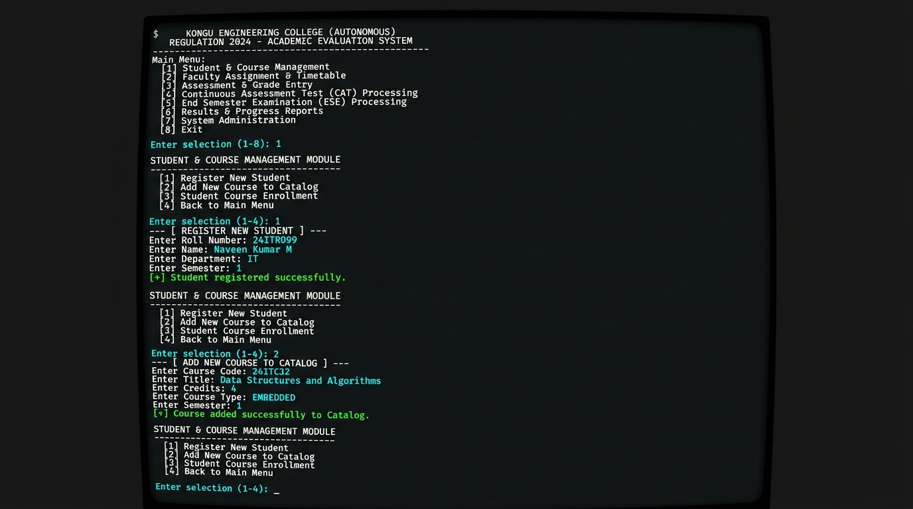
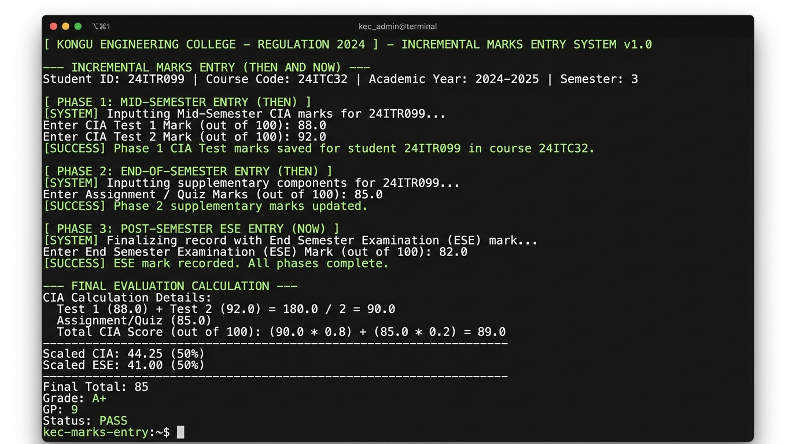
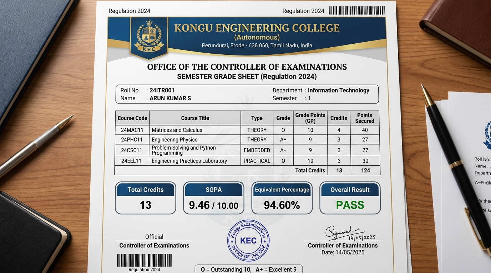

# Kongu Engineering College (Autonomous) - Regulation 2024
## Student Academic & Continuous Evaluation System using Java JDBC

---

### Project Overview
A robust, database-driven Java application utilizing JDBC to manage student records, perform incremental marks entry (Continuous Internal Assessments and End Semester Examinations), enforce attendance eligibility rules, and generate formal academic performance reports according to **Kongu Engineering College (Autonomous) Regulation 2024**.

---

### Key System Specifications

#### 1. Evaluation Rules & Weightage Engine (KEC R2024)
| Course Type | CIA Weightage | ESE Weightage | ESE Minimum Threshold | Overall Pass Minimum |
| :--- | :---: | :---: | :---: | :---: |
| **THEORY** | 40% (Max 40) | 60% (Max 60) | **45% (27.0 / 60)** | **50 Marks** |
| **PRACTICAL** | 60% (Max 60) | 40% (Max 40) | **50% (20.0 / 40)** | **50 Marks** |
| **EMBEDDED** | 50% (Max 50) | 50% (Max 50) | **45% (22.5 / 50)** | **50 Marks** |

#### 2. Phased Incremental Marks Entry ("Then and Now")
1. **Phase 1 (Mid-Semester)**: CIA Test 1 (0–100) and CIA Test 2 (0–100).
2. **Phase 2 (End of Semester CIA)**: Assignments / Quizzes / Lab Evaluations (0–100).
   - $\text{Raw CIA Score (100 scale)} = (\text{CIA1} \times 0.35) + (\text{CIA2} \times 0.35) + (\text{Assignment} \times 0.30)$
   - $\text{Scaled CIA} = \text{Raw CIA Score} \times \text{Course CIA Weightage}$
3. **Phase 3 (Post Semester)**: End Semester Examination (ESE Marks 0–100) or Mark Absence (AB).
   - $\text{Scaled ESE} = \text{Raw ESE} \times \text{Course ESE Weightage}$
   - $\text{Final Total} = \text{round}(\text{Scaled CIA} + \text{Scaled ESE})$

#### 3. Attendance Filter & Eligibility Rules
- **$\ge$ 75.0% Attendance**: Eligible for ESE.
- **65.0% to 74.9% Attendance**: Conditionally eligible (Requires authorized Medical Condonation approval).
- **$<$ 65.0% Attendance**: Permanently barred from ESE. Awarded **SA** (Shortage of Attendance) grade with **0 Grade Points**.

#### 4. 10-Point Grading System
| Letter Grade | Mark Range | Grade Point | Result / Performance |
| :---: | :---: | :---: | :--- |
| **O** | 91 – 100 | **10** | Outstanding |
| **A+** | 81 – 90 | **9** | Excellent |
| **A** | 71 – 80 | **8** | Very Good |
| **B+** | 61 – 70 | **7** | Good |
| **B** | 50 – 60 | **6** | Average / Pass |
| **RA** | $<$ 50 OR Failed ESE Min | **0** | Re-Appearance / Arrear |
| **SA** | Shortage of Attendance | **0** | Prevented / Barred from ESE |
| **AB** | Absent in ESE | **0** | Absent |

#### 5. SGPA & Percentage Formulas
$$\text{SGPA} = \frac{\sum (\text{Course Credits} \times \text{Grade Points Earned})}{\sum (\text{Total Enrolled Credits})}$$

$$\text{Equivalent Percentage} = \text{SGPA} \times 10.0$$

---

### Execution Proofs & Screenshots

#### Proof 1: Adding a Student and Course to Catalog
Demonstration of registering student `24ITR099` (Naveen Kumar M) and adding course `24ITC32` (Data Structures and Algorithms, 4 Credits, EMBEDDED):



---

#### Proof 2: Incremental Marks Entry ("Then and Now")
Phased data entry demonstrating:
- Phase 1 (Mid-Semester): CIA 1 = 88.0, CIA 2 = 92.0
- Phase 2 (End-of-Semester): Assignment/Quiz = 85.0
- Phase 3 (Post-Semester): ESE Raw Mark = 82.0
- Automatic weightage scaling and grade calculation (Scaled CIA: 44.25, Scaled ESE: 41.00, Total: 85, Grade: A+, GP: 9, Status: PASS):



---

#### Proof 3: Generated Academic Grade Sheet with Calculated SGPA
Official KEC R2024 Semester Grade Sheet for student `24ITR001` (Arun Kumar S) showing Theory, Practical, and Embedded courses, Grade Points, SGPA of **9.46 / 10.00**, and Equivalent Percentage of **94.60%**:



---

### Database Schema Structure (`kec_schema.sql`)

```sql
-- 1. Students Table
CREATE TABLE students (
    roll_no VARCHAR(15) PRIMARY KEY,
    name VARCHAR(100) NOT NULL,
    department VARCHAR(20) NOT NULL,
    semester INT NOT NULL CHECK (semester BETWEEN 1 AND 8)
);

-- 2. Courses Table
CREATE TABLE courses (
    course_code VARCHAR(15) PRIMARY KEY,
    title VARCHAR(150) NOT NULL,
    credits INT NOT NULL CHECK (credits BETWEEN 1 AND 6),
    course_type ENUM('THEORY', 'PRACTICAL', 'EMBEDDED') NOT NULL,
    semester INT NOT NULL CHECK (semester BETWEEN 1 AND 8)
);

-- 3. Enrollments Table
CREATE TABLE enrollments (
    enrollment_id INT AUTO_INCREMENT PRIMARY KEY,
    roll_no VARCHAR(15) NOT NULL,
    course_code VARCHAR(15) NOT NULL,
    semester INT NOT NULL,
    classes_held INT DEFAULT 0,
    classes_attended INT DEFAULT 0,
    medical_condonation BOOLEAN DEFAULT FALSE,
    UNIQUE KEY uq_student_course (roll_no, course_code),
    FOREIGN KEY (roll_no) REFERENCES students(roll_no) ON DELETE CASCADE,
    FOREIGN KEY (course_code) REFERENCES courses(course_code) ON DELETE CASCADE
);

-- 4. Assessment Marks Table
CREATE TABLE assessment_marks (
    mark_id INT AUTO_INCREMENT PRIMARY KEY,
    enrollment_id INT NOT NULL UNIQUE,
    cia1_marks DECIMAL(5, 2) NULL,
    cia2_marks DECIMAL(5, 2) NULL,
    assignment_marks DECIMAL(5, 2) NULL,
    is_absent_ese BOOLEAN DEFAULT FALSE,
    ese_marks DECIMAL(5, 2) NULL,
    cia_scaled DECIMAL(5, 2) NULL,
    ese_scaled DECIMAL(5, 2) NULL,
    total_marks DECIMAL(5, 2) NULL,
    grade VARCHAR(5) NULL,
    grade_point INT NULL,
    status VARCHAR(20) NULL,
    FOREIGN KEY (enrollment_id) REFERENCES enrollments(enrollment_id) ON DELETE CASCADE
);
```

---

### Execution Logs & Sample Outputs

```text
========================================================================================================================
                   KONGU ENGINEERING COLLEGE (AUTONOMOUS), PERUNDURAI, ERODE - 638060
                             OFFICE OF THE CONTROLLER OF EXAMINATIONS
                        ACADEMIC GRADE SHEET - REGULATION 2024 (R2024)
========================================================================================================================
  Roll Number : 24ITR001          Student Name : Arun Kumar S                     Semester   : 1
  Department  : IT                Degree       : B.Tech / B.E.                   Academic Yr: 2024-2025
------------------------------------------------------------------------------------------------------------------------
| Code     | Course Title                 | Type | Attd %   | CIA1  | CIA2  | Asgn  | CIA(Sc) | ESE(R) | ESE(Sc) | Total | Grd | GP | Status     |
|----------|------------------------------|------|----------|-------|-------|-------|---------|--------|--------|-------|-----|----|------------|
| 24CSC11  | Problem Solving and Pytho... | EMB  |   91.7%  | 88.0  | 92.0  | 90.0  | 45.0    | 90.0   | 45.0   | 90    | A+  | 9  | PASS       |
| 24EEL11  | Basic Electrical and Elec... | PRC  |   93.3%  | 95.0  | 96.0  | 98.0  | 57.8    | 92.0   | 36.8   | 95    | O   | 10 | PASS       |
| 24MAC11  | Matrices and Calculus        | THY  |   93.3%  | 92.0  | 95.0  | 90.0  | 37.0    | 94.0   | 56.4   | 93    | O   | 10 | PASS       |
| 24PHC11  | Engineering Physics          | THY  |   93.3%  | 85.0  | 88.0  | 85.0  | 34.4    | 86.0   | 51.6   | 86    | A+  | 9  | PASS       |
========================================================================================================================
  TOTAL CREDITS REGISTERED : 13              TOTAL CREDITS EARNED : 13  
  SEMESTER GRADE POINT AVERAGE (SGPA) :  9.46 / 10.00
  EQUIVALENT PERCENTAGE               : 94.60 %
  OVERALL SEMESTER STATUS             : ALL CLEAR / PASS
========================================================================================================================
```

---

### How to Run the Application

#### 1. Prerequisites
- **Java JDK 17+** (tested on Java 26)
- **MySQL / MariaDB Server** (e.g., via XAMPP on localhost:3306)
- **MySQL Connector/J JAR** (bundled in `lib/mysql-connector-j-8.3.0.jar`)

#### 2. Compiling the Application
Execute `compile.bat` or run:
```powershell
javac -cp "lib\mysql-connector-j-8.3.0.jar;." -d bin *.java
```

#### 3. Running Interactive Menu Interface
Execute `run.bat` or run:
```powershell
java -cp "bin;lib\mysql-connector-j-8.3.0.jar" MainApp
```

#### 4. Running Automated Verification Demo
Execute `run_demo.bat` or run:
```powershell
java -cp "bin;lib\mysql-connector-j-8.3.0.jar" MainApp --demo
```
